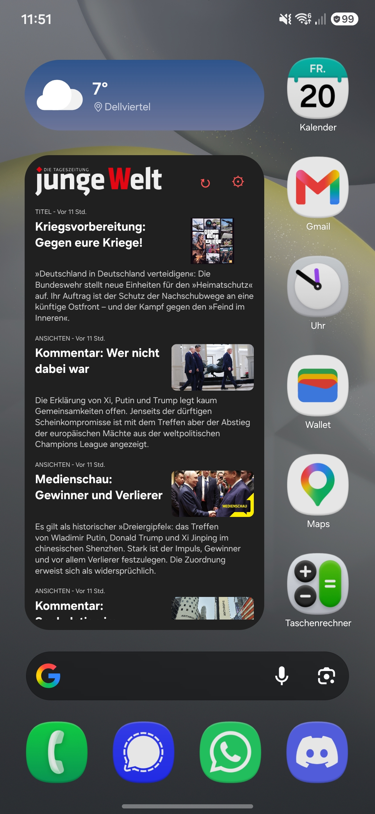
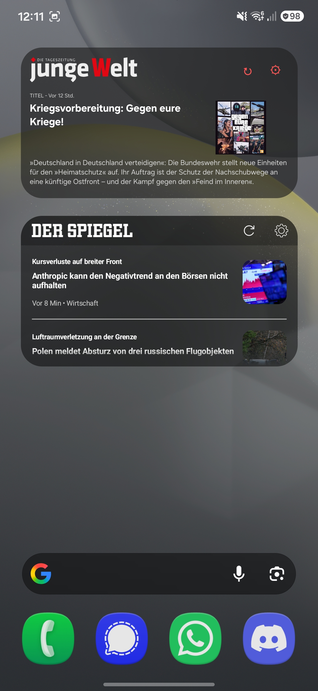
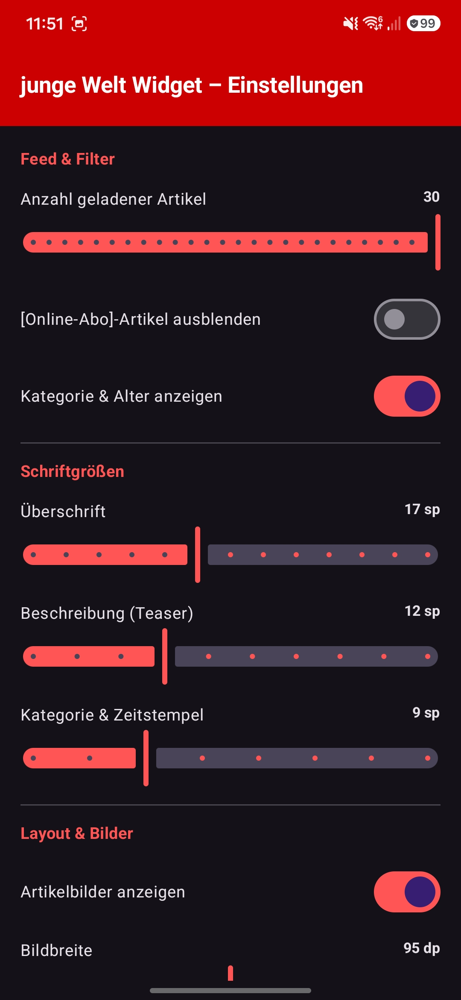

# JWWidget – junge Welt Android Homescreen-Widget

Ein natives Android-Homescreen-Widget auf Basis von **Jetpack Glance**, das den aktuellen RSS-Newsticker der Tageszeitung [junge Welt](https://jungewelt.de) direkt auf dem Startbildschirm anzeigt.

## Screenshots

| Widget (3×5 Raster) | Widget (4×2 Raster) | Einstellungen (Compose) |
| :---: | :---: | :---: |
|  |  |  |

## Features

- **Aktueller RSS-Newsticker:** Lädt die neuesten Beiträge direkt aus dem offiziellen Feed (`https://jungewelt.de/feeds/newsticker.rss`).
- **Scrollbare Artikelliste:** Zeigt Kategorie, relatives Alter (z. B. *„vor 17 Min.“*), Schlagzeile, Teaser-Text und Vorschaubild in Original-Seitenverhältnis.
- **Direkte Navigation:**
  - Antippen eines Artikels öffnet den vollständigen Beitrag im Standard-Browser.
  - Antippen des Logos im Header führt zur Startseite von *junge Welt*.
  - Manueller Reload-Button (`↻`) oben rechts für sofortige Aktualisierung.
  - Einstellungs-Button (`⚙`) oben rechts zum direkten Öffnen der Konfiguration.
- **Hell- & Dunkelmodus:** Passt Hintergrund, Schriftfarben und Vektor-Logo automatisch an das System-Theme (Day/Night) an.
- **Flexible Widget-Größe:** Horizontal und vertikal frei skalierbar (ab 3 Spalten Breite).
- **Umfangreiche Einstellungsseite (Jetpack Compose):**
  - Anzahl geladener Artikel (5–30)
  - Optionales Ausblenden von `[Online-Abo]`-Artikeln
  - Individuelle Schriftgrößen für Überschrift, Beschreibung und Metadaten
  - Ein-/Ausschalten sowie Größenanpassung von Vorschaubildern, Beschreibungstext und Logo
  - Anpassbare Hintergrund-Deckkraft

## Tech-Stack

- **Sprache:** Kotlin
- **Widget-UI:** Jetpack Glance (`androidx.glance:glance-appwidget`)
- **Settings-UI:** Jetpack Compose & Material 3
- **RSS-Parsing:** Android `XmlPullParser` mit MRSS-Namespace-Unterstützung (`media:content`)
- **Nebenläufigkeit:** Kotlin Coroutines (`async` / `awaitAll` für paralleles Laden der Thumbnails)
- **AI:** Dieses Projekt wurde zum großen Teil mit ChatGPT und Gemini vibecoded

## Installation & Entwicklung

### Voraussetzungen
- Android Studio (Ladybug oder neuer empfohlen)
- Android SDK (Min. SDK entsprechend `build.gradle.kts`, empfohlen ab Android 8.0 / API 26; volle abgerundete Ecken & Theme-Features ab Android 12 / API 31)

### Projekt lokal einrichten
1. Repository klonen:
   ```bash
   git clone https://github.com
   ```
2. Projekt in **Android Studio** öffnen (*File -> Open* -> Ordner `JWWidget` auswählen).
3. Gradle-Sync abwarten und die App über **Run (`▶`)** auf einem Emulator oder verbundenen Android-Gerät installieren.
4. Auf dem Homescreen eine freie Stelle gedrückt halten -> **Widgets** -> **JWWidget** auswählen und platzieren.

## Projektstruktur

```text
├── app/src/main/
│   ├── java/com/example/jwwidget/
│   │   ├── JWWidget.kt                # Haupt-UI & Layout des Glance-Widgets
│   │   ├── JWWidgetReceiver.kt        # AppWidgetProvider / BroadcastReceiver
│   │   ├── WidgetActions.kt           # Klick-Aktionen (URL im Browser öffnen, Reload)
│   │   ├── WidgetSettings.kt          # Einstellungs-Modell & SharedPreferences-Repository
│   │   ├── MainActivity.kt            # Einstellungs-Screen (Jetpack Compose)
│   │   └── RssReader.kt               # XML-Parser für den junge Welt RSS-Feed
│   └── res/
│       ├── drawable/ic_jw_logo.xml         # Logo für hellen Hintergrund
│       ├── drawable-night/ic_jw_logo.xml   # Logo für dunklen Hintergrund
│       └── xml/jw_widget_info.xml          # Widget-Metadaten (Größe, Update-Intervall)
└── design/                            # Quell-SVGs, App-Icon & Screenshots
```

## Hinweise zum Betrieb (Energiesparmodus)

Damit das Widget auf Geräten mit aggressivem Hintergrund-Management (z. B. Samsung One UI) zuverlässig aktualisiert, empfiehlt es sich, in den Android-App-Einstellungen unter **Akku** die Option **„Nicht eingeschränkt“** für *JWWidget* zu aktivieren.

## Lizenz & Hinweis

Dies ist ein inoffizielles Open-Source-Community-Projekt und steht in keiner offiziellen Verbindung zum Verlag 8. Mai GmbH / *junge Welt*. Alle abgerufenen Inhalte und Markenrechte liegen bei den jeweiligen Rechteinhabern.
